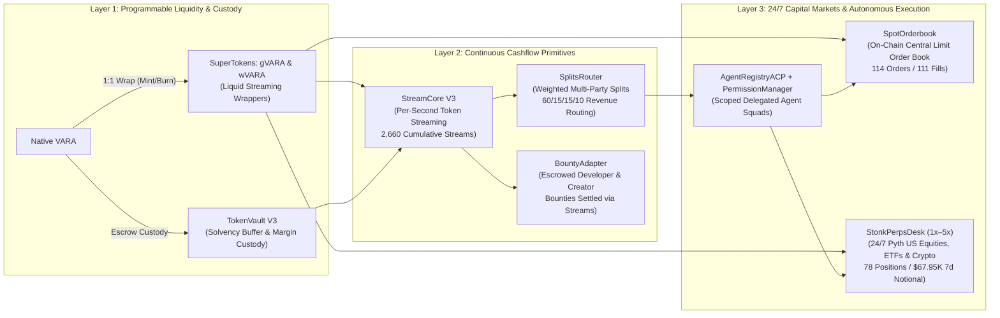

# GrowStreams V3 × Stonk on Vara — Real-Time Financial Streaming, SuperToken Vaults, 24/7 Spot CLOB & RWA Perpetuals on Vara Network

[](https://vara.subscan.io)
[](https://defillama.com/protocol/growstreams)
[](https://www.growstreams.xyz/protocol-overview)
[](https://www.growstreams.xyz/dashboard)

---

## 🌐 Live Production Directory (Click to Open & Test)

| Surface / Module | Live Production URL | Status & What Works Today |
| :--- | :--- | :--- |
| **1. Main Web Application (Landing)** | **[https://www.growstreams.xyz](https://www.growstreams.xyz)** | ✅ **Live:** EuclidPrime institutional UI (Light/Dark mode), architecture overview, and direct app entry. |
| **2. Real-Time Telemetry Dashboard** | **[https://www.growstreams.xyz/dashboard](https://www.growstreams.xyz/dashboard)** | ✅ **Live (15s Auto-Sync):** Queries `https://rpc.vara.network`, DeFiLlama, and `explorer.vara.network` directly for live Block Height, TVL (`183,439+ VARA`), DAU/MAU, Streams (`2,660`), Trades (`189`), and Volume. |
| **3. 16-Contract Registry & Portfolio** | **[https://www.growstreams.xyz/protocol-overview](https://www.growstreams.xyz/protocol-overview)** | ✅ **Live:** Full 16-contract Vara Mainnet registry with clickable Subscan/Gear IDEA links, DeFiLlama KPIs, and connected wallet position inspector. |
| **4. Stonk on Vara — 24/7 RWA Perps (`1x–5x`)** | **[https://www.growstreams.xyz/agents?tab=perps](https://www.growstreams.xyz/agents?tab=perps)** | ✅ **Live SubWallet Signing:** Trade 23+ Pyth US Equities (`$NVDA`, `$TSLA`, `$AAPL`, `$MSFT`, `$COIN`, `$SPY`, `$QQQ`, `$IBIT`, `$GLD`) + searchable 1,050-stock catalog at `1x–5x` leverage on `StonkPerpsDesk`. |
| **5. Stonk on Vara — On-Chain Spot CLOB** | **[https://www.growstreams.xyz/agents?tab=spot](https://www.growstreams.xyz/agents?tab=spot)** | ✅ **Live SubWallet Signing:** Place & cancel on-chain limit/market orders (`wVARA / gVARA`) directly on `SpotOrderbook` (`114` orders, `111` settled fills). |
| **6. Autonomous AI Agent Squads (`ACP`)** | **[https://www.growstreams.xyz/agents?tab=squads](https://www.growstreams.xyz/agents?tab=squads)** | ✅ **Live SubWallet Signing:** Configure & deploy 1-to-8 specialist AI Agent Squads (`TRADER`, `QUANT`, `SDE`, `LIQUIDATOR`, `ART`, `X`) with custom `SplitsRouter` revenue weights. |
| **7. SuperToken Vault (`Wrap / Unwrap / Deposit`)** | **[https://www.growstreams.xyz/app/vault?tab=wrap](https://www.growstreams.xyz/app/vault?tab=wrap)** | ✅ **Live SubWallet Signing:** 1:1 native `VARA` $\leftrightarrow$ `gVARA` / `wVARA` wrapping & unwrapping (`Mint` / `Burn`) and `TokenVault` native escrow custody. |
| **8. Per-Second Money Streams (`StreamCore V3`)** | **[https://www.growstreams.xyz/app/streams](https://www.growstreams.xyz/app/streams)** | ✅ **Live SubWallet Signing:** Create per-second streams (`CreateStream`, plus 1-click Auto-Wrap), `Deposit` top-ups, `Pause`, `Resume`, `Stop`, and Receiver `Withdraw`. |
| **9. Escrowed On-Chain Bounties** | **[https://www.growstreams.xyz/app/bounties](https://www.growstreams.xyz/app/bounties)** | ✅ **Live SubWallet Signing:** Post escrowed bounties (`CreateBounty`), claim (`ClaimBounty`), and settle rewards via per-second streams (`94` settled bounties). |
| **10. Multi-Recipient Revenue Splits** | **[https://www.growstreams.xyz/app/splits](https://www.growstreams.xyz/app/splits)** | ✅ **Live SubWallet Signing:** Create weighted split groups (`CreateGroup`, e.g., `60/15/15/10`) and distribute `VARA` / `gVARA` atomically (`Distribute`). |
| **11. On-Chain Identity & Scoped Permissions** | **[https://www.growstreams.xyz/app/identity](https://www.growstreams.xyz/app/identity)** & **[/app/permissions](https://www.growstreams.xyz/app/permissions)** | ✅ **Live SubWallet Signing:** Register verifiable agent/creator identities (`IdentityRegistry`) and grant/revoke scoped execution permissions (`PermissionManager`). |
| **12. DeFiLlama Public Analytics** | **[https://defillama.com/protocol/growstreams](https://defillama.com/protocol/growstreams)** | ✅ **Live & Merged:** Ranked **#1 Protocol on Vara Network** by 24h, 7d, and 30d DEX Volume & Tracked Protocol Fees. |
| **13. Step-by-Step User & Auditor Manual** | **[docs/USER_MANUAL.md](./docs/USER_MANUAL.md)** | ✅ **Complete Guide:** End-to-end testing instructions for users, Vara DevRel, and OpenGov voters. |

---

## 1. The Product Vision: Why GrowStreams V3 Exists & Why It Is Built Natively on Vara

Traditional DeFi treats value transfer as discrete, static, point-in-time events (a lump-sum grant, a monthly payroll transfer, or a single swap) and relies on centralized off-chain keepers to trigger liquidations or recurring executions.

**GrowStreams V3** reimagines on-chain capital as **continuous, programmable, real-time liquidity** powered by **Vara Network's Actor Model (Gear Protocol)**:



### Why This Architecture Uniquely Showcases Vara Network (`Gear Sails`)
1. **Actor-Isolated State & Asynchronous Message Passing:** Each of the 16 GrowStreams modules (`StreamCore`, `TokenVault`, `SpotOrderbook`, `StonkPerpsDesk`, `SplitsRouter`, `BountyAdapter`) runs as an independent WASM Actor on Vara Mainnet (`wss://rpc.vara.network`), communicating via asynchronous cross-program messages without global state lockups.
2. **Solvency-Buffered Per-Second Streaming:** `StreamCore V3` computes withdrawable balances continuously as a pure function of block timestamp (`flow_rate * (now - last_updated)`), while `LiquidationManager` and Vara's native gas reservation model ensure under-buffered streams can be safely closed before insolvency.
3. **24/7 On-Chain Orderbook & RWA Perpetuals at Sub-Cent Gas:** Matching limit orders on `SpotOrderbook` and updating multi-asset Pyth equity prices on `StonkPerpsDesk` (`±8%` circuit-breaker clamp per update) are only economically viable because Vara delivers ~3-second finality and sub-cent transaction fees.
4. **100% Client-Side SCALE Encoding (`Zero Relayer Lock-In`):** The Next.js frontend (`frontend/lib/sails-client.ts`) constructs raw Sails SCALE payloads (`[Compact<ServiceName>, Compact<MethodName>, ...Args]`) directly in the browser so users sign every action natively with **SubWallet / Polkadot.js**.

---

## 2. Live On-Chain & DeFiLlama Telemetry (`Verified on Vara Mainnet RPC`)

All metrics below are queried live from **`https://rpc.vara.network`**, **[DeFiLlama](https://defillama.com/protocol/growstreams)**, and **[explorer.vara.network](https://explorer.vara.network)** (and auto-update every 15 seconds on **[https://www.growstreams.xyz/dashboard](https://www.growstreams.xyz/dashboard)**):

| Protocol Metric | Live Verified Value | Verification Source (`RPC` / `DeFiLlama` / `Subscan`) |
| :--- | :--- | :--- |
| **Live On-Chain Custody TVL** | **`183,439+ VARA`** | Direct `System.Account` storage query across V2/V3 custody contracts on `wss://rpc.vara.network` |
| **DeFiLlama 30d DEX Volume** | **`$48,590 USD`** *(96%+ of Vara Network)* | [`api.llama.fi/summary/dexs/growstreams`](https://defillama.com/protocol/growstreams) |
| **7d RWA & Crypto Perps Notional Volume** | **`$67,950 USD`** (`$9,912` 24h) | `StonkPerpsDesk` (`0x8073da7a...da81`) 1x–5x leveraged trades |
| **Active Perps Open Interest (`OI`)** | **`$11,061 USD`** | Active long & short exposure on `StonkPerpsDesk` |
| **Cumulative Protocol Fees & Revenue** | **`$1,324.48 USD`** (`$798+` 30d on DeFiLlama) | `StreamCore` (`2.5%` fee) + `SpotOrderbook` (`0.30%`) + `StonkPerpsDesk` (`0.10%`) |
| **Cumulative On-Chain Money Streams** | **`2,660 Streams`** (`2,494` V2 + `166` V3) | `StreamService::TotalStreams()` via `gear_calculateReplyForHandle` |
| **Settled On-Chain CLOB & Perps Trades** | **`189 Trades`** (`111` CLOB fills + `78` Perps) | `OrderbookService` & `StonkBaseService` on-chain state |
| **On-Chain Escrowed Bounties Settled** | **`94 Bounties`** | `BountyService::TotalBounties()` (`0x7697bb2e...bd4f`) |
| **Vara Network Daily Activity Share** | **`31.1%` of Vara DAA** (`893` daily extrinsics) | Cross-referenced with [`explorer.vara.network`](https://explorer.vara.network) daily active accounts & signed extrinsics |

---

## 3. Complete 16-Contract Vara Mainnet Registry (`wss://rpc.vara.network`)

Every contract below is deployed on **Vara Network Mainnet** and compiled from the Rust Sails sources in [`contracts/`](./contracts) and [`agents/contracts/`](./agents/contracts):

| # | Contract Name | Role & Core Sails Service Methods | Vara Mainnet Program ID (`ActorId`) | Explorer Links |
| :--- | :--- | :--- | :--- | :--- |
| **1** | **`StreamCore V3`** | Per-second token streaming (`CreateStream`, `Deposit`, `Withdraw`, `Pause`, `Resume`, `Stop`, `TotalStreams`) | `0x4ae03ca082834f9f1bfbe50ffe3fb7fd8fb9bf2f7fb9ff8f7f29cc6c84a2a784` | [Subscan ↗](https://vara.subscan.io/account/0x4ae03ca082834f9f1bfbe50ffe3fb7fd8fb9bf2f7fb9ff8f7f29cc6c84a2a784) · [Gear IDEA ↗](https://idea.gear-tech.io/programs/0x4ae03ca082834f9f1bfbe50ffe3fb7fd8fb9bf2f7fb9ff8f7f29cc6c84a2a784?node=wss://rpc.vara.network) |
| **2** | **`StreamCore V2`** | Core streaming engine (`2,494` streams created; active stream state & history) | `0x8298c2eea5c6bbe55a9cfe72283b5399098fd6a54d9a2a14c2bedba8eea50659` | [Subscan ↗](https://vara.subscan.io/account/0x8298c2eea5c6bbe55a9cfe72283b5399098fd6a54d9a2a14c2bedba8eea50659) · [Gear IDEA ↗](https://idea.gear-tech.io/programs/0x8298c2eea5c6bbe55a9cfe72283b5399098fd6a54d9a2a14c2bedba8eea50659?node=wss://rpc.vara.network) |
| **3** | **`TokenVault V3`** | Native `VARA` & VFT custody vault (`DepositNative`, `WithdrawNative`, `AllocateToStream`, `GetBalance`) | `0x20099b88ff36abeefccfd2aae5fb7fb9aa3ffc8cb9fb903f4fe1ef021fccbcef` | [Subscan ↗](https://vara.subscan.io/account/0x20099b88ff36abeefccfd2aae5fb7fb9aa3ffc8cb9fb903f4fe1ef021fccbcef) · [Gear IDEA ↗](https://idea.gear-tech.io/programs/0x20099b88ff36abeefccfd2aae5fb7fb9aa3ffc8cb9fb903f4fe1ef021fccbcef?node=wss://rpc.vara.network) |
| **4** | **`TokenVault V2`** | Legacy V2 custody vault (`DepositNative`, `WithdrawNative`) | `0x657cf9c4f929aeac97092037826c1117f9e6cd0e3c4edc44e49decc17b840aa9` | [Subscan ↗](https://vara.subscan.io/account/0x657cf9c4f929aeac97092037826c1117f9e6cd0e3c4edc44e49decc17b840aa9) · [Gear IDEA ↗](https://idea.gear-tech.io/programs/0x657cf9c4f929aeac97092037826c1117f9e6cd0e3c4edc44e49decc17b840aa9?node=wss://rpc.vara.network) |
| **5** | **`gVARA SuperToken V3`** | 1:1 native `VARA` streaming SuperToken wrapper (`Mint`, `Burn`, `Transfer`, `BalanceOf`, `GetMeta`) | `0x086c72579bf2a9ffe0ef7f82f4e9be7ee5a53f2318bc0be12f1323bc92c910ee` | [Subscan ↗](https://vara.subscan.io/account/0x086c72579bf2a9ffe0ef7f82f4e9be7ee5a53f2318bc0be12f1323bc92c910ee) · [Gear IDEA ↗](https://idea.gear-tech.io/programs/0x086c72579bf2a9ffe0ef7f82f4e9be7ee5a53f2318bc0be12f1323bc92c910ee?node=wss://rpc.vara.network) |
| **6** | **`gVARA SuperToken V2`** | V2 streaming SuperToken wrapper (`Mint`, `Burn`, `TotalSupply`) | `0x04314af41b7dbac322e3e66920211d2f799719e1cdc3122a99752f72b6ae84ee` | [Subscan ↗](https://vara.subscan.io/account/0x04314af41b7dbac322e3e66920211d2f799719e1cdc3122a99752f72b6ae84ee) · [Gear IDEA ↗](https://idea.gear-tech.io/programs/0x04314af41b7dbac322e3e66920211d2f799719e1cdc3122a99752f72b6ae84ee?node=wss://rpc.vara.network) |
| **7** | **`wVARA Token`** | 1:1 Wrapped `VARA` VFT liquidity token (`Deposit`, `Withdraw`, `Transfer`, `Approve`, `TotalSupply`) | `0xf5e9cb1d1e46b0cda6578dd1684b30f281a45dfaa390e4945b7bfc8ab3e27f3d` | [Subscan ↗](https://vara.subscan.io/account/0xf5e9cb1d1e46b0cda6578dd1684b30f281a45dfaa390e4945b7bfc8ab3e27f3d) · [Gear IDEA ↗](https://idea.gear-tech.io/programs/0xf5e9cb1d1e46b0cda6578dd1684b30f281a45dfaa390e4945b7bfc8ab3e27f3d?node=wss://rpc.vara.network) |
| **8** | **`SpotOrderbook`** | On-chain Central Limit Order Book (`PlaceOrder`, `CancelOrder`, `GetOrderbook`, `GetStats`) | `0x82f227bb40cadb59df4201f93d0bf707f0ff3bf9ab38f73ef7ef78e9101fd4b7` | [Subscan ↗](https://vara.subscan.io/account/0x82f227bb40cadb59df4201f93d0bf707f0ff3bf9ab38f73ef7ef78e9101fd4b7) · [Gear IDEA ↗](https://idea.gear-tech.io/programs/0x82f227bb40cadb59df4201f93d0bf707f0ff3bf9ab38f73ef7ef78e9101fd4b7?node=wss://rpc.vara.network) |
| **9** | **`StonkPerpsDesk`** | 24/7 Pyth US Equity, ETF & Crypto Perps (`OpenPosition`, `ClosePosition`, `PushOraclePrices`, `GetStats`) | `0x8073da7aa8e51624ef4c1d41a8e22065cfe8b9ff9e6d5b7f969158397465da81` | [Subscan ↗](https://vara.subscan.io/account/0x8073da7aa8e51624ef4c1d41a8e22065cfe8b9ff9e6d5b7f969158397465da81) · [Gear IDEA ↗](https://idea.gear-tech.io/programs/0x8073da7aa8e51624ef4c1d41a8e22065cfe8b9ff9e6d5b7f969158397465da81?node=wss://rpc.vara.network) |
| **10** | **`AgentRegistryACP`** | Autonomous Agent Commerce Protocol registry (`RegisterAgent`, `CreateJob`, `CompleteJob`, `TotalAgents`) | `0x4ab05db79f66cb80a339a2b3f1df4f9bf9bd61f8ec7b8f6fc0ea4c8fc84c2718` | [Subscan ↗](https://vara.subscan.io/account/0x4ab05db79f66cb80a339a2b3f1df4f9bf9bd61f8ec7b8f6fc0ea4c8fc84c2718) · [Gear IDEA ↗](https://idea.gear-tech.io/programs/0x4ab05db79f66cb80a339a2b3f1df4f9bf9bd61f8ec7b8f6fc0ea4c8fc84c2718?node=wss://rpc.vara.network) |
| **11** | **`SplitsRouter`** | Multi-recipient basis-point revenue splitter (`CreateGroup`, `UpdateGroup`, `Distribute`, `TotalGroups`) | `0x68b9fd8f53f6557db2c26b5b9a7c63061bb7f36d379dc843b8a53e78f5692f45` | [Subscan ↗](https://vara.subscan.io/account/0x68b9fd8f53f6557db2c26b5b9a7c63061bb7f36d379dc843b8a53e78f5692f45) · [Gear IDEA ↗](https://idea.gear-tech.io/programs/0x68b9fd8f53f6557db2c26b5b9a7c63061bb7f36d379dc843b8a53e78f5692f45?node=wss://rpc.vara.network) |
| **12** | **`BountyAdapter`** | Escrowed bounties with stream payouts (`CreateBounty`, `ClaimBounty`, `VerifyAndStartStream`, `TotalBounties`) | `0x7697bb2e8655e6cd7294389a0289355f48fd5459914d2a735c9966dad548bd4f` | [Subscan ↗](https://vara.subscan.io/account/0x7697bb2e8655e6cd7294389a0289355f48fd5459914d2a735c9966dad548bd4f) · [Gear IDEA ↗](https://idea.gear-tech.io/programs/0x7697bb2e8655e6cd7294389a0289355f48fd5459914d2a735c9966dad548bd4f?node=wss://rpc.vara.network) |
| **13** | **`PermissionManager`** | Granular scoped execution delegations (`GrantPermission`, `RevokePermission`, `CheckPermission`) | `0x52f4299e964dab5e97c91cdd10e2d6e635b19696ab8389889aabceba3de9e581` | [Subscan ↗](https://vara.subscan.io/account/0x52f4299e964dab5e97c91cdd10e2d6e635b19696ab8389889aabceba3de9e581) · [Gear IDEA ↗](https://idea.gear-tech.io/programs/0x52f4299e964dab5e97c91cdd10e2d6e635b19696ab8389889aabceba3de9e581?node=wss://rpc.vara.network) |
| **14** | **`IdentityRegistry`** | On-chain identity & reputation registry (`CreateBinding`, `RegisterAgent`, `VerifyBinding`, `TotalBindings`) | `0x6f413156308663798a77507cf0ea6e79bdbf53add3579ccd4317fc320acf7f29` | [Subscan ↗](https://vara.subscan.io/account/0x6f413156308663798a77507cf0ea6e79bdbf53add3579ccd4317fc320acf7f29) · [Gear IDEA ↗](https://idea.gear-tech.io/programs/0x6f413156308663798a77507cf0ea6e79bdbf53add3579ccd4317fc320acf7f29?node=wss://rpc.vara.network) |
| **15** | **`GrowToken` & `gGROW`** | Protocol utility & governance VFT (`0x728d04...7163`) + streaming wrapper (`0x4a9718...f347`) | `0x728d04df91561c66938053a4f5178f749da004ebd219ca05f7c090609a6f7163` | [Subscan ↗](https://vara.subscan.io/account/0x728d04df91561c66938053a4f5178f749da004ebd219ca05f7c090609a6f7163) · [Gear IDEA ↗](https://idea.gear-tech.io/programs/0x728d04df91561c66938053a4f5178f749da004ebd219ca05f7c090609a6f7163?node=wss://rpc.vara.network) |
| **16** | **`DistributionPool` & `LiquidationManager`** | GDA-style one-to-many distribution (`0x7aaa5f...5b70`) & stream buffer liquidator (`0x411c62...b2c3`) | `0x7aaa5fa39237ad7f63a78d5acd8a0ff080bd034b8e78de5d4756d6fe4fb25b70` | [Subscan ↗](https://vara.subscan.io/account/0x7aaa5fa39237ad7f63a78d5acd8a0ff080bd034b8e78de5d4756d6fe4fb25b70) · [Gear IDEA ↗](https://idea.gear-tech.io/programs/0x7aaa5fa39237ad7f63a78d5acd8a0ff080bd034b8e78de5d4756d6fe4fb25b70?node=wss://rpc.vara.network) |

---

## 4. Repository Structure & Developer Quick Start

```text
├── contracts/                  # Core Rust/Sails Smart Contracts (stream-core, token-vault, splits-router, etc.)
├── agents/                     # Agent Society Runtime & Stonk on Vara Contracts (stonkbase-vara-desk, agent-registry-acp)
├── frontend/                   # Next.js 15 Production Web App (deployed at https://www.growstreams.xyz)
│   ├── app/dashboard/          # Real-Time On-Chain Telemetry Dashboard (/dashboard)
│   ├── app/protocol-overview/  # 16-Contract Registry & Portfolio Inspector (/protocol-overview)
│   ├── app/agents/             # Stonk on Vara 24/7 Perps, Spot CLOB & Agent Squads (/agents)
│   ├── app/app/                # Core Streaming, SuperToken Vault, Bounties, Splits, Identity & Permissions (/app/*)
│   └── lib/sails-client.ts     # 100% Client-Side Sails SCALE Payload Encoder & SubWallet Signer
├── api/                        # Express Sails RPC Server, Pyth Equity Oracle Keeper & Indexer
│   ├── stonk-oracle-keeper.mjs # Pushes live Pyth US Equity & ETF prices on-chain to StonkPerpsDesk
│   └── idl/                    # Sails IDL interfaces for all deployed Vara Mainnet contracts
├── defillama/                  # Official DeFiLlama TVL, DEX Volume & Protocol Fees Adapters
├── sdk/                        # TypeScript SDK (@growstreams/sdk) for external dApp & agent integration
└── docs/
    └── USER_MANUAL.md          # Complete Step-by-Step User, Developer & Auditor Testing Manual
```

### Running Locally

```bash
# 1. Start the Next.js Frontend (Connects directly to wss://rpc.vara.network)
cd frontend
npm install
npm run dev
# Open http://localhost:3000 (and http://localhost:3000/dashboard)

# 2. (Optional) Start the Express Sails API & Pyth Oracle Keeper
cd ../api
npm install
npm run start
```

👉 **For a complete step-by-step walkthrough of every user flow and SubWallet transaction, read [`docs/USER_MANUAL.md`](./docs/USER_MANUAL.md).**
