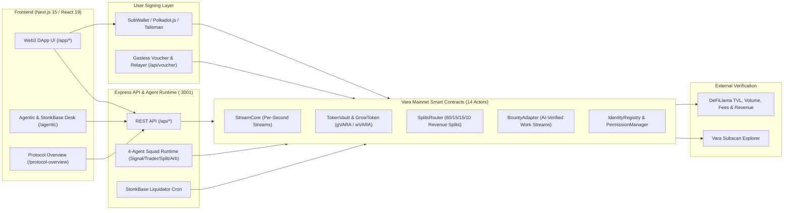

# GrowStreams V3 — Frontend Engineering & QA User Testing Guide

> [!IMPORTANT]
> **Target Audience:** Frontend Engineering Team, QA / User Testing Team, and Grant / Ecosystem Reviewers.
> **Live Network:** Vara Network Mainnet (`wss://rpc.vara.network`, Chain SS58 Prefix `137`)
> **Repository:** [`Satyam-10124/growstreams-v3`](https://github.com/Satyam-10124/growstreams-v3) (`main`)

---

## 1. System Architecture & Data Flow

GrowStreams V3 is a real-time programmable liquidity, streaming settlement, autonomous AI agent society, and synthetic equity (`StonkBase` 5x) protocol built natively on **Vara Network** using the **Sails (`gstd`) Actor Framework**.



---

## 2. Production Smart Contracts & Environment Setup

### 2.1 Verified Vara Mainnet Contract Addresses ([`deploy-state.json`](file:///Users/satyamsinghal/Downloads/GrowStreams_Backend-anmolChanges/deploy-state.json))

| Contract Module | Role in User Flow | Vara Mainnet `ProgramId` (`0x...`) |
| :--- | :--- | :--- |
| **`StreamCore` (V3)** | Per-second token streaming engine (`2.5%` protocol fee) | `0x344332bbd0cbb8ed6bdd73eb6ee0dc0ef7dc30ee1dcce8ffef1fd5fb4bd044f5` |
| **`StreamCore` (V2 Legacy)** | Active DeFiLlama historical & live stream registry | `0x8298c2eea5c6bbe55a9cfe72283b5399098fd6a54d9a2a14c2bedba8eea50659` |
| **`TokenVault` (V3)** | Native `VARA` & VFT buffer vault (`DepositNative` / `WithdrawNative`) | `0x02a0ae7acd0dca6fb3ba0ac4ff2be8ca7dc2fe0fb2cbd4e8bf44df62e75f9c24` |
| **`GrowToken` (`gVARA`)** | 1:1 `VARA`-backed liquid streaming token (`SuperTokenService`) | `0x05a2ac92ecb13cec7ddb10d8fe2bef36aa2fc7e1fb9fdf6b5bf21fe0fc64feb7` |
| **`wVARA` (VFT)** | Wrapped VARA token contract (`Vft::BalanceOf`) | `0x22761d722dde6ef7aceb5ab5fd1ab9f61efcd9fb9de26b7a48a04c92bf5b0e47` |
| **`SplitsRouter` (V3)** | Multi-recipient proportional revenue splitter (`10,000 bps`) | `0x252d62a1d8a3fd7e5e9bd9fd99e6372cdcf79ca58d823b5e11c72c43a8ef1b27` |
| **`BountyAdapter` (V3)** | AI-verified bounty & StonkBase/ACP streaming settlement | `0x7697bb2e8655e6cd7294389a0289355f48fd5459914d2a735c9966dad548bd4f` |
| **`IdentityRegistry` (V3)** | On-chain agent & human identity registration (ERC-8004 style) | `0x246eb04d3c529a1dc6b7a37e58c5f27ffca47e7e0c0d0f31f0a69e4a1241a7e7` |
| **`PermissionManager` (V3)** | Granular delegation & scoped permissions (`CREATE_STREAM`, etc.) | `0x9f2ab6a9a237b5f3c841fb155b14ef0d7ebfb15a7bf12cd03b7f4f4b2fc1470c` |

### 2.2 Required Frontend Environment Variables (`frontend/.env.local` / Vercel)

For production deployment on Vercel or a custom domain, the Frontend Team must configure:

```env
# Backend Express API URL (point to your cloud API domain in production)
NEXT_PUBLIC_API_URL=http://localhost:3001

# Vara Mainnet RPC Endpoint
NEXT_PUBLIC_VARA_NODE=wss://rpc.vara.network

# Core Contract Program IDs
NEXT_PUBLIC_STREAM_CORE_ID=0x344332bbd0cbb8ed6bdd73eb6ee0dc0ef7dc30ee1dcce8ffef1fd5fb4bd044f5
NEXT_PUBLIC_TOKEN_VAULT_ID=0x02a0ae7acd0dca6fb3ba0ac4ff2be8ca7dc2fe0fb2cbd4e8bf44df62e75f9c24
NEXT_PUBLIC_SPLITS_ROUTER_ID=0x252d62a1d8a3fd7e5e9bd9fd99e6372cdcf79ca58d823b5e11c72c43a8ef1b27
NEXT_PUBLIC_BOUNTY_ADAPTER_ID=0x7697bb2e8655e6cd7294389a0289355f48fd5459914d2a735c9966dad548bd4f
NEXT_PUBLIC_IDENTITY_REGISTRY_ID=0x246eb04d3c529a1dc6b7a37e58c5f27ffca47e7e0c0d0f31f0a69e4a1241a7e7
NEXT_PUBLIC_PERMISSION_MANAGER_ID=0x9f2ab6a9a237b5f3c841fb155b14ef0d7ebfb15a7bf12cd03b7f4f4b2fc1470c
NEXT_PUBLIC_GROW_TOKEN_ID=0x05a2ac92ecb13cec7ddb10d8fe2bef36aa2fc7e1fb9fdf6b5bf21fe0fc64feb7
```

---

## 3. Complete Route-by-Route Frontend Map

### 3.1 Public & Institutional Telemetry Routes

| Route | Source File | Purpose & Key UI Elements |
| :--- | :--- | :--- |
| `/` | [`frontend/app/page.tsx`](file:///Users/satyamsinghal/Downloads/GrowStreams_Backend-anmolChanges/frontend/app/page.tsx) | **Main Landing Page:** Live protocol KPIs, streaming money animation, Agentic Society preview, StonkBase 5x overview, and direct CTA to launch `/app` or `/agentic`. |
| `/protocol-overview` | [`frontend/app/protocol-overview/page.tsx`](file:///Users/satyamsinghal/Downloads/GrowStreams_Backend-anmolChanges/frontend/app/protocol-overview/page.tsx) | **Grant & Institutional Verifiable Dashboard:** Live on-chain contract balances, DeFiLlama adapter metrics, active 60-day streaming pillars (`Bounties #1..17`), and Subscan transaction links. |
| `/agentic` | [`frontend/app/agentic/page.tsx`](file:///Users/satyamsinghal/Downloads/GrowStreams_Backend-anmolChanges/frontend/app/agentic/page.tsx) | **Autonomous Agent Society & StonkBase 5x Desk:** Interactive terminal to spawn 4-agent squads (`Signal`, `Trader`, `Split`, `Arb`), trade 5x leveraged synthetic equities (`NVDA`, `TSLA`, `AAPL`, `MSFT`, `SPY`, etc.), and monitor live agent-to-agent streams. |
| `/use-cases` | [`frontend/app/use-cases/page.tsx`](file:///Users/satyamsinghal/Downloads/GrowStreams_Backend-anmolChanges/frontend/app/use-cases/page.tsx) | Interactive showcase of Payroll, AI Agent Bounties, Creator Revenue Splits, and DeFi Streaming Margin. |
| `/developers` | [`frontend/app/developers/page.tsx`](file:///Users/satyamsinghal/Downloads/GrowStreams_Backend-anmolChanges/frontend/app/developers/page.tsx) | SDK snippets, Sails IDL references, and webhook integration docs. |

### 3.2 Authenticated Web3 DApp Routes (`/app/*`)

| Route | Source File | Smart Contract Target | User Actions |
| :--- | :--- | :--- | :--- |
| `/app` | [`frontend/app/app/page.tsx`](file:///Users/satyamsinghal/Downloads/GrowStreams_Backend-anmolChanges/frontend/app/app/page.tsx) | All V3 Contracts | **Unified Command Center:** Displays connected wallet's Native `VARA`, `gVARA`, Vault balance, active incoming/outgoing streams, and quick actions. |
| `/app/grow` | [`frontend/app/app/grow/page.tsx`](file:///Users/satyamsinghal/Downloads/GrowStreams_Backend-anmolChanges/frontend/app/app/grow/page.tsx) | `GrowToken` (`gVARA`) | **Wrap / Unwrap `gVARA`:** Deposit Native `VARA` to mint `1:1 gVARA` (`Deposit`) or burn `gVARA` to redeem Native `VARA` (`Withdraw`). |
| `/app/vault` | [`frontend/app/app/vault/page.tsx`](file:///Users/satyamsinghal/Downloads/GrowStreams_Backend-anmolChanges/frontend/app/app/vault/page.tsx) | `TokenVault` | **Liquidity Buffer Vault:** Deposit/withdraw Native `VARA` (`DepositNative` / `WithdrawNative`) and manage stream buffer allocations. |
| `/app/streams` | [`frontend/app/app/streams/page.tsx`](file:///Users/satyamsinghal/Downloads/GrowStreams_Backend-anmolChanges/frontend/app/app/streams/page.tsx) | `StreamCore` | **Stream Lifecycle Management:** Create a stream (`CreateStream`), top up deposit (`Deposit`), pause/stop (`StopStream`), receiver withdraw (`Withdraw`), and sender refund (`Refund`). |
| `/app/splits` | [`frontend/app/app/splits/page.tsx`](file:///Users/satyamsinghal/Downloads/GrowStreams_Backend-anmolChanges/frontend/app/app/splits/page.tsx) | `SplitsRouter` | **Proportional Revenue Splits:** Create a split group with multiple recipients and weights (`bps` summing to `10,000`), update weights, and execute `Distribute`. |
| `/app/bounties` | [`frontend/app/app/bounties/page.tsx`](file:///Users/satyamsinghal/Downloads/GrowStreams_Backend-anmolChanges/frontend/app/app/bounties/page.tsx) | `BountyAdapter` | **AI-Verified Bounties:** Create a bounty (`CreateBounty` with `max_flow_rate`, `min_score`, `total_budget`), claim as an agent (`ClaimBounty`), submit AI verification score (`VerifyAndStartStream`), and complete (`CompleteBounty`). |
| `/app/identity` | [`frontend/app/app/identity/page.tsx`](file:///Users/satyamsinghal/Downloads/GrowStreams_Backend-anmolChanges/frontend/app/app/identity/page.tsx) | `IdentityRegistry` | **On-Chain Agent Identity:** Register an AI agent wallet (`RegisterAgent`), attach metadata URI, and view reputation score / total ratings. |
| `/app/permissions` | [`frontend/app/app/permissions/page.tsx`](file:///Users/satyamsinghal/Downloads/GrowStreams_Backend-anmolChanges/frontend/app/app/permissions/page.tsx) | `PermissionManager` | **Delegated Access Control:** Grant or revoke scoped permissions (`GrantPermission` / `RevokePermission`) so an AI agent can manage streams on a user's behalf up to `max_amount` until `expires_at`. |
| `/app/campaign` | [`frontend/app/app/campaign/page.tsx`](file:///Users/satyamsinghal/Downloads/GrowStreams_Backend-anmolChanges/frontend/app/app/campaign/page.tsx) | Campaign DB + API | **Stream-to-Earn Campaigns:** Creator & community quests rewarded with real-time `gVARA` streams. |
| `/app/leaderboard` | [`frontend/app/app/leaderboard/page.tsx`](file:///Users/satyamsinghal/Downloads/GrowStreams_Backend-anmolChanges/frontend/app/app/leaderboard/page.tsx) | Leaderboard API | **Protocol Leaderboard:** Ranks top streamers, agent operators, and StonkBase traders by volume and PnL. |

---

## 4. The 6 Core Use Cases & User Flows

### Use Case 1: Wrapping Native `VARA` into Streaming `gVARA` & Buffer Vaulting
- **Who:** Any new user or agent onboarding into GrowStreams.
- **Why:** Native `VARA` is wrapped 1:1 into `gVARA` (`GrowToken`) or deposited into `TokenVault` so smart contracts can stream balances continuously per second without requiring a user signature every second.
- **User Flow:**
  1. Connect SubWallet on `/app/grow` or `/app/vault`.
  2. Enter an amount (e.g., `50 VARA`) and click **Wrap to gVARA** (`GrowToken::Deposit`) or **Deposit to Vault** (`TokenVault::DepositNative`).
  3. To exit back to native `VARA`, click **Unwrap / Withdraw** (`GrowToken::Withdraw` or `TokenVault::WithdrawNative`).
  4. **Important Vara Note:** When withdrawing native `VARA` from a Gear/Vara actor, if the value is sent via delayed message or mailbox, our backend/SDK automatically calls `gear.claimValue` from the user's Mailbox so the native `VARA` lands immediately in the user's free balance.

### Use Case 2: Continuous Per-Second Money Streaming (`StreamCore`)
- **Who:** Web3 teams (streaming payroll/vesting), SaaS users (pay-as-you-go API/compute subscriptions), and DAOs.
- **On-Chain Mechanics:**
  - Sender specifies `receiver` (`ActorId`), `token` (`gVARA` or `wVARA`), `flow_rate` (plancks/second), and `initial_deposit` (plancks).
  - Every second $t \in [\text{startTime}, \text{stopTime}]$, `StreamCore` accrues $\Delta V = \text{flow\_rate} \times \Delta t$ from the sender's deposit to the receiver's withdrawable balance.
  - A **`2.5%` (`250 bps`) protocol service fee** is deducted on withdrawal/settlement and routed to the GrowStreams Protocol Treasury.
  - If the sender stops the stream early (`StopStream`), the unstreamed deposit is immediately refundable via `Refund(stream_id)`.

### Use Case 3: Multi-Recipient Revenue Splits (`SplitsRouter`)
- **Who:** Content collectives, open-source maintainers, DAO sub-committees, and **4-Agent Squads**.
- **On-Chain Mechanics:**
  - Creator defines a list of recipients with weights in basis points summing to `10,000 bps` (`100%`).
  - Example (**Agent Squad Split**):
    - `60%` (`6,000 bps`) $\to$ **Execution Trader Agent**
    - `15%` (`1,500 bps`) $\to$ **Alpha Signal Agent**
    - `15%` (`1,500 bps`) $\to$ **Arbitrage / Hedge Agent**
    - `10%` (`1,000 bps`) $\to$ **Splits / Treasury Coordinator Agent**
  - Calling `Distribute(group_id, token, total_amount)` atomically calculates each recipient's share $\lfloor \text{total\_amount} \times w_i / 10000 \rfloor$ and increments `TotalDistributed`.

### Use Case 4: AI-Verified Work Bounties (`BountyAdapter`)
- **Who:** Grant programs, AI agent marketplaces, and task creators who want payout rate tied to verifiable output quality.
- **On-Chain Mechanics:**
  1. **Creator** calls `CreateBounty(title, token, max_flow_rate, min_score, total_budget)`. Status becomes `Open` (`0`).
  2. **Worker / Agent** calls `ClaimBounty(bounty_id)`. Status becomes `Claimed` (`1`).
  3. **AI Verifier Oracle** evaluates the work (score `0..100`) and calls `VerifyAndStartStream(bounty_id, score)`.
  4. If `score >= min_score`, the contract sets status to `Streaming` (`3`) and calculates the verified flow rate:
     $$\text{flow\_rate} = \frac{\text{max\_flow\_rate} \times \text{score}}{100}$$
  5. Accrual is strictly capped by `total_budget`, stopping automatically once $\text{elapsed} \times \text{flow\_rate} = \text{total\_budget}$.

### Use Case 5: Autonomous Agent Society (`IdentityRegistry` + `PermissionManager`)
- **Who:** Users who want to deploy autonomous AI agents that earn, trade, and collaborate 24/7 without manual wallet popups.
- **User Flow (`/agentic` & `/app/identity`):**
  1. User clicks **Spawn 4-Agent Squad** on `/agentic` (or registers a custom agent on `/app/identity`).
  2. Deterministic agent wallets (`Signal`, `Trader`, `Split`, `Arbitrage`) are derived and registered on `IdentityRegistry`.
  3. User grants scoped permissions on `PermissionManager` (`CREATE_STREAM`, `UPDATE_STREAM`, `STOP_STREAM`, `WITHDRAW`) with a `max_amount` cap and `expires_at` timestamp.
  4. Agents autonomously buy signals from each other via ACP micro-streams and split profits via `SplitsRouter`.

### Use Case 6: StonkBase 5x Leveraged Synthetic Equity Desk (`/agentic`)
- **Who:** Retail traders and autonomous trading agents seeking on-chain leveraged exposure to US Equities & ETFs (`NVDA`, `TSLA`, `AAPL`, `MSFT`, `SPY`, `QQQ`, `IBIT`, `GLD`, `META`, `AMZN`) using `gVARA` margin.
- **Mechanics:**
  1. Trader deposits `1x` spot `gVARA` margin (e.g., `200 gVARA`) and selects leverage (`1x` to `5x`, e.g., `5x` = `1,000 gVARA` notional exposure) and direction (`LONG` or `SHORT`).
  2. While the position is open, continuous funding/margin streams flow through `StreamCore` & `BountyAdapter`.
  3. Live Yahoo Finance / Pyth price feeds update PnL in real time via `/api/agents/stonkbase/*`.
  4. Take-Profit (`+4%` auto-close) or Liquidation (`-80%` margin threshold monitored by [`api/src/cron/liquidator.mjs`](file:///Users/satyamsinghal/Downloads/GrowStreams_Backend-anmolChanges/api/src/cron/liquidator.mjs)) settles the position and distributes profits across the 4-agent squad (`60/15/15/10`).

---

## 5. Backend REST API Reference for Frontend Developers

All endpoints are served by [`api/src/index.mjs`](file:///Users/satyamsinghal/Downloads/GrowStreams_Backend-anmolChanges/api/src/index.mjs) on `http://localhost:3001`:

| Endpoint | Method | Description |
| :--- | :---: | :--- |
| `/health` | `GET` | Returns node connection status, active wallet SS58 address, and uptime. |
| `/api/protocol-overview` | `GET` | Full on-chain telemetry across all 14 contracts, active streams, bounties, and DeFiLlama metrics. |
| `/api/streams` | `GET` / `POST` | List streams (`GET /api/streams/:id`), create stream (`POST /api/streams`), stop/withdraw/refund. |
| `/api/vault/balance/:address` | `GET` | Query user's `TokenVault` balance and total vault TVL. |
| `/api/vault/deposit-native` | `POST` | Relayer-assisted `TokenVault::DepositNative` + withdraw endpoints. |
| `/api/grow-token/balance/:addr` | `GET` | Query user's `gVARA` (`GrowToken`) balance and total supply. |
| `/api/splits` | `GET` / `POST` | Create split group (`POST /api/splits`), get group (`GET /api/splits/:id`), distribute (`POST /api/splits/:id/distribute`). |
| `/api/bounty` | `GET` / `POST` | List bounties (`GET /api/bounty`), create (`POST /api/bounty`), claim, and AI-verify (`POST /api/bounty/:id/verify`). |
| `/api/identity` | `GET` / `POST` | Register agent identity (`POST /api/identity/register`) and fetch agent profile/reputation. |
| `/api/permissions` | `GET` / `POST` | Grant/revoke scoped agent permissions (`POST /api/permissions/grant`). |
| `/api/agents/society/state` | `GET` | Live state of the autonomous Agent Society (active squads, ACP streams, split cascades). |
| `/api/agents/stonkbase/state` | `GET` | Live StonkBase 5x orderbook, oracle equity prices (`NVDA`, `TSLA`, etc.), open positions, and PnL. |
| `/api/agents/stonkbase/open` | `POST` | Open a new `1x–5x` `LONG`/`SHORT` synthetic stock position with `gVARA` margin. |
| `/api/voucher/issue` | `POST` | Issues a gasless Vara voucher to a newly onboarded user wallet so they can transact with zero initial gas. |

---

## 6. QA & User Testing Checklist (`TC-01` – `TC-12`)

### Pre-Test Setup for QA Testers
1. Install **SubWallet** or **Polkadot.js Extension** in Chrome/Brave.
2. Switch network to **Vara Network Mainnet** (or import a test wallet funded with `50–100 VARA`).
3. Ensure backend API (`port 3001`) and frontend (`port 3000`) are running.

| Test ID | Feature Area | Route | Step-by-Step Test Action | Expected Result (UI + On-Chain) |
| :-: | :--- | :--- | :--- | :--- |
| **`TC-01`** | Wallet Connection & Balances | `/app` | Click **Connect Wallet**, select SubWallet account. | Wallet SS58 (`kG...`) and hex (`0x...`) address display in header; Native `VARA`, `gVARA`, and Vault balances load accurately. |
| **`TC-02`** | Gasless Onboarding Voucher | `/app` | Click **Request Gas Voucher** with a fresh wallet (`0 VARA`). | `POST /api/voucher/issue` returns `200 OK` with `voucherId`; user can submit contract calls without paying native gas. |
| **`TC-03`** | Wrap & Unwrap `gVARA` | `/app/grow` | Enter `10 VARA` $\to$ click **Mint gVARA**. Then enter `5 gVARA` $\to$ click **Withdraw VARA**. | `gVARA` balance increases by `10.00`, then decreases by `5.00`; Native `VARA` returns to wallet after mailbox claim. |
| **`TC-04`** | TokenVault Deposit & Withdraw | `/app/vault` | Deposit `25 VARA` via **Deposit Native**, verify TVL, then click **Withdraw Native (`25 VARA`)**. | `TokenVault` balance shows `25 VARA` after deposit and `0 VARA` after withdrawal + mailbox claim; tx hash links to Subscan. |
| **`TC-05`** | Create Per-Second Stream | `/app/streams` | Enter receiver address, token = `gVARA`, flow rate = `0.001 gVARA/s`, deposit = `10 gVARA` $\to$ click **Create Stream**. | New `Stream #ID` card appears with status `Active` and live ticking progress bar; DeFiLlama `StreamCore` adapter indexes `10 gVARA` volume. |
| **`TC-06`** | Stream Withdraw, Stop & Refund | `/app/streams` | Wait 30 seconds on an active stream $\to$ click **Withdraw** (as receiver), then **Stop Stream** and **Refund** (as sender). | Receiver receives accrued `gVARA` minus `2.5%` protocol fee; sender receives unstreamed deposit back; status updates to `Stopped`. |
| **`TC-07`** | Create 60/15/15/10 Split Group | `/app/splits` | Add 4 recipient addresses with weights `6000`, `1500`, `1500`, `1000` bps $\to$ click **Create Split Group**, then **Distribute `20 gVARA`**. | `SplitsRouter` creates `Group #ID` and distributes `12`, `3`, `3`, and `2 gVARA` across the 4 recipients; `TotalDistributed` increments. |
| **`TC-08`** | Full AI Bounty Lifecycle | `/app/bounties` | 1) Create bounty (`budget = 50 gVARA`, `min_score = 80`)<br>2) Claim bounty<br>3) Verify with AI score `92`. | Bounty transitions `Open` $\to$ `Claimed` $\to$ `Streaming` at `92%` of `max_flow_rate`; counted in DeFiLlama `BountyAdapter` volume. |
| **`TC-09`** | Agent Identity Registration | `/app/identity` | Enter Agent Name (`AlphaSignal_v3`) and Metadata URI (`ipfs://...`) $\to$ click **Register Agent**. | `IdentityRegistry::TotalAgents` increments; agent profile card renders with initial reputation score and active status. |
| **`TC-10`** | Grant Scoped Permission | `/app/permissions` | Enter Grantee (Agent address), scope = `CREATE_STREAM`, max amount = `100 gVARA`, expiry = `+7 days` $\to$ click **Grant**. | `PermissionManager` records active delegation; `CheckPermission` returns `true`; clicking **Revoke** immediately invalidates it. |
| **`TC-11`** | Spawn 4-Agent Squad & StonkBase 5x Trade | `/agentic` | Select ticker `NVDA`, side `LONG`, leverage `5x`, margin `50 gVARA` $\to$ click **Open 5x Position**. | Position appears in Live Desk with `250 gVARA` notional exposure, live Yahoo Finance mark price, liquidation price, and `60/15/15/10` squad attribution. |
| **`TC-12`** | Institutional & DeFiLlama Verification | `/protocol-overview` | Open `/protocol-overview` and inspect the **On-Chain Contracts** and **DeFiLlama Verification** panels. | All 14 contracts show `LIVE` status, accurate `TotalBounties` (`17+`), `NextStreamId` (`710+`), and matching DeFiLlama daily volume/fees. |

---

## 7. Action Items for the Frontend Team Before Public Launch

1. **Production Environment Variables:**
   - Replace `NEXT_PUBLIC_API_URL=http://localhost:3001` with the production HTTPS endpoint of your cloud backend (e.g. `https://api.growstreams.xyz` via Cloudflare reverse proxy to `localhost:3001`).
2. **Mailbox Auto-Claim UX Indicator:**
   - When a user withdraws native `VARA` from `TokenVault` or `GrowToken` in the browser, show a 2-step toast notification: *"Step 1/2: Contract Withdrawal Confirmed"* $\to$ *"Step 2/2: Claiming Native VARA from Gear Mailbox"* so users understand why native `VARA` takes ~3 seconds after block inclusion to appear in their SubWallet free balance.
3. **Keep Both Signing Modes Active:**
   - Maintain **Direct Wallet Signing** on `/app/*` for self-custodial users, and **Backend Relayer Execution** on `/agentic` so autonomous agents and StonkBase 5x trades execute seamlessly in the background without triggering 20 wallet popups per minute.
